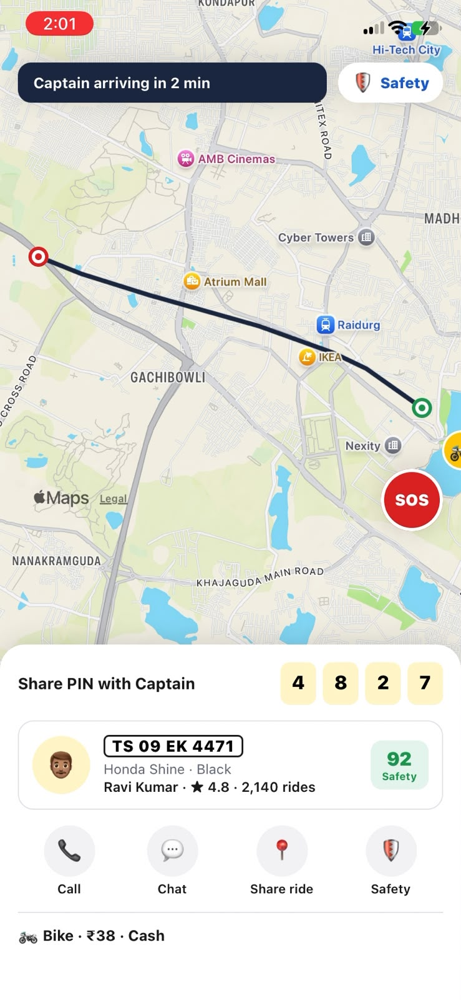
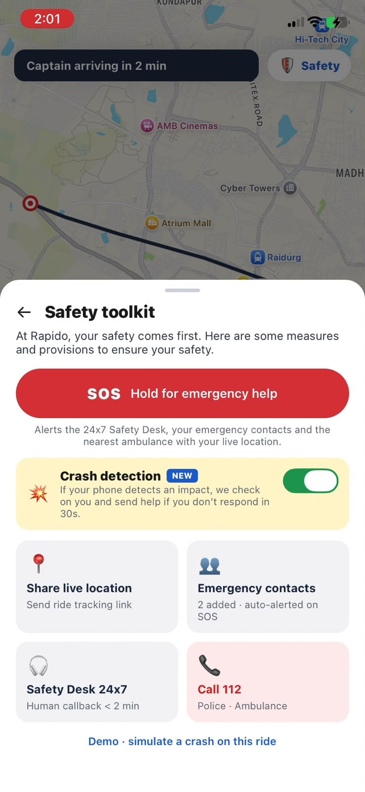
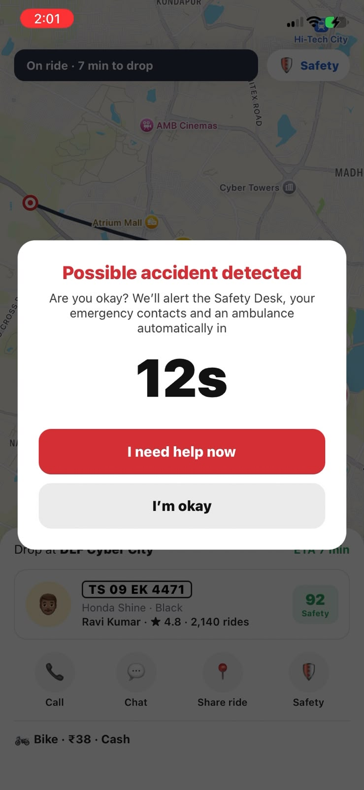
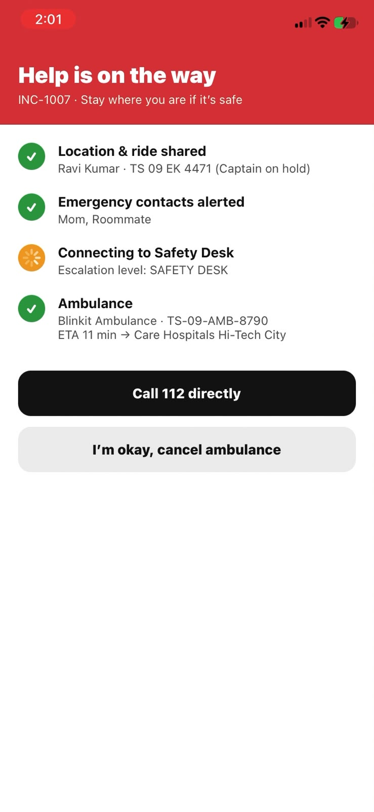

# Rapido Safety: SOS & Escalation prototype

Built in response to Dev Boddu's post: an accident at 11:10 PM got its first human callback at 12:50 AM. Target: **human on the line in under 2 minutes, ambulance requested in under 60 seconds.**

> ⚠️ Independent concept prototype. Not an official Rapido product.

## 🎥 Demo video

https://github.com/user-attachments/assets/6b188a84-0fdb-4d74-9be0-a7662db6aff3

## 📱 Screenshots

| Live ride | Safety toolkit | Crash detected | Help is on the way |
|:---:|:---:|:---:|:---:|
|  |  |  |  |
| Captain PIN, Safety score, SOS button | SOS, crash detection, contacts, 112 | 30 s "Are you okay?" check | Contacts alerted, desk connecting, ambulance ETA |

## Structure

```
app/      React Native (Expo SDK 57) rider app with the safety feature module
server/   Node mock backend (zero deps): SOS engine, escalation engine,
          mock ambulance-partner APIs, Safety Desk dashboard
```

## Run

```bash
# 1. Backend + dashboard
cd server && node index.js          # http://localhost:4000  (dashboard)

# 2. Rider app
cd app && npx expo start            # scan QR with Expo Go (same Wi-Fi)
```

The app finds the server automatically through the Expo dev host. If it can't, set `EXPO_PUBLIC_SAFETY_API=http://<your-PC-IP>:4000`. Allow port 4000 through Windows Firewall.

## Demo script (about 90 seconds, good for a screen recording)
1. **Home:** tap *Where are you going?* (note the *New: Crash Protection* banner).
2. **Choose ride:** Bike / Auto / Cab with prices, plus *Crash Protection included*. Tap **Book Bike**.
3. **Finding Captain:** shows matching only with Captains rated 4.5+ with a safety score of 80+.
4. **Live ride:** the Captain approaches, the PIN is shown, then the bike moves along the route on a real map. The Captain card shows a **Safety score**.
5. Tap **🛡️ Safety** to open the **Safety toolkit**: hold SOS, toggle crash detection, share location, call 112.
6. Tap *Demo · simulate a crash*: a 30 s *Are you okay?* countdown, then the SOS goes out automatically. Alternatively, long-press the red **SOS** button on the map.
7. Keep the laptop dashboard in the same shot: the P0 card appears, the ambulance partner fallback runs, and escalation fires if nobody acknowledges.

## Feature module (`app/src/features/safety/`)
| File | Role |
|---|---|
| `SafetyToolkitSheet.js` | Rapido-style Safety toolkit with SOS, crash toggle, contacts, 112 |
| `SafetyLayer.js` | Drop-in wrapper for any in-ride screen; wires everything together |
| `SosButton.js` | Hold-to-trigger SOS button (prevents pocket presses), with haptics |
| `useCrashDetection.js` | Accelerometer: >3.5 g impact followed by 2.5 s of stillness counts as a crash |
| `CrashCheckModal.js` | 30 s "Are you okay?" check; no answer triggers an automatic SOS |
| `SosActiveScreen.js` | Live progress: contacts alerted, desk connected, ambulance ETA, call 112 |
| `api.js` | Safety API client |

To add it to the real Rapido app, wrap the in-ride screen in `<SafetyLayer ride={ride}>`.

## API
| Method | Path | |
|---|---|---|
| POST | `/api/sos` | Raise incident `{trigger, location, rider, captain, ride, emergencyContacts}` |
| GET | `/api/incidents[/:id]` | List / get |
| POST | `/api/incidents/:id/ack \| note \| resolve \| cancel` | Desk & rider actions |
| POST | `/partners/:blinkit\|redhealth\|erss112/dispatch` | Mock ambulance partners (random failures/timeouts) |

Demo timings are compressed (see `CFG` in `server/index.js`); the production values are in the comments.
